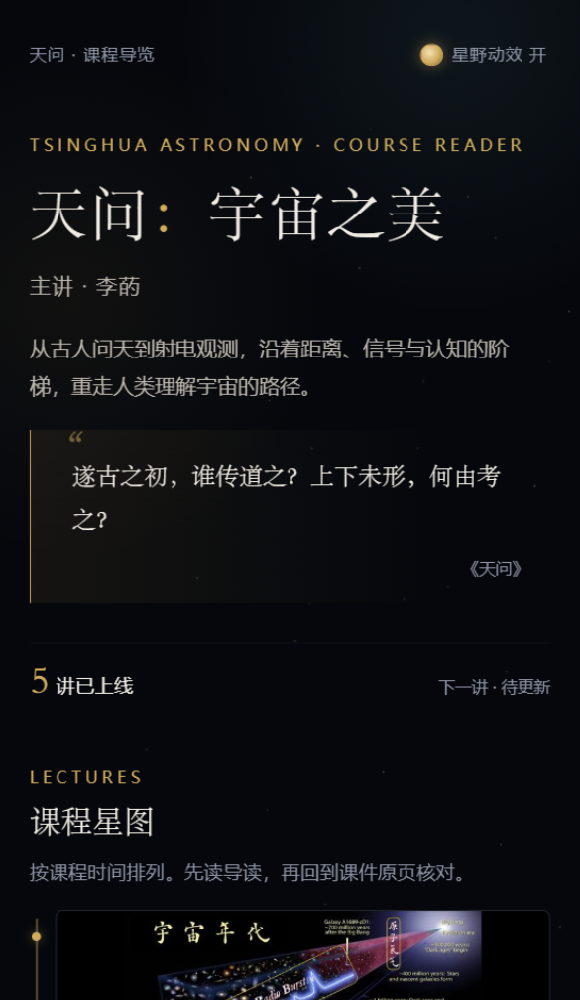
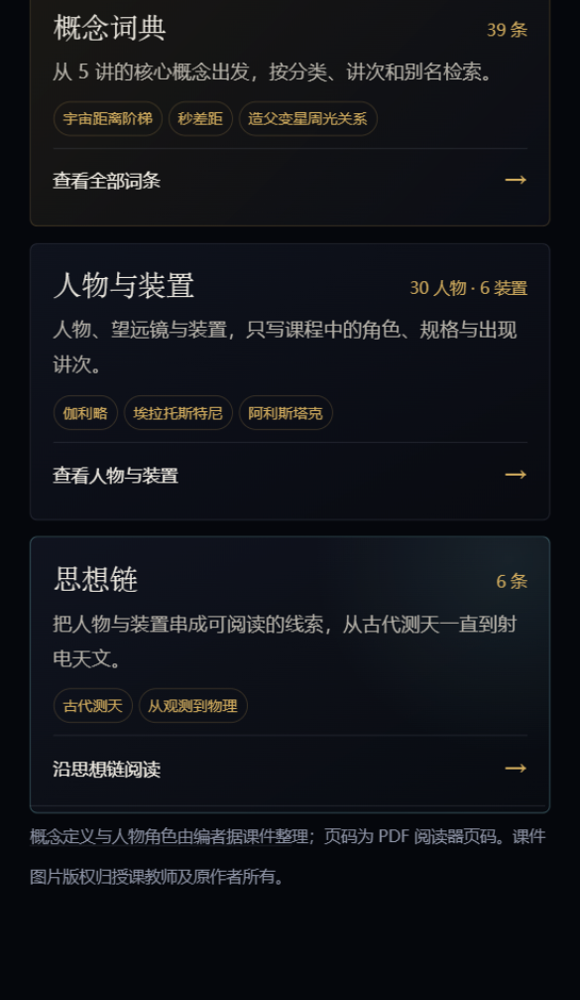
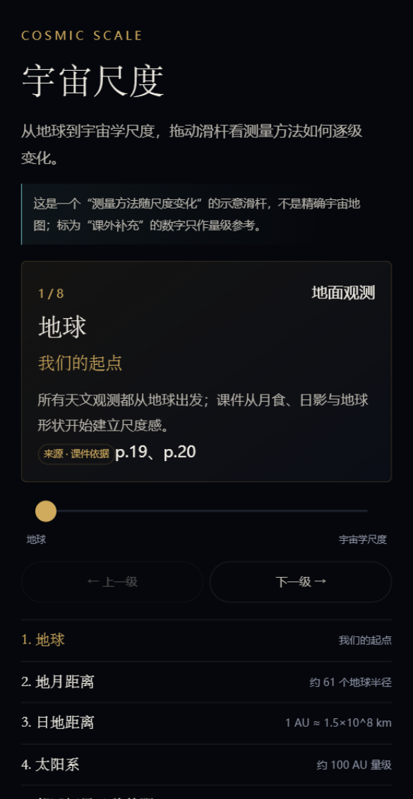

# 天问：宇宙之美 · 课程小程序

《天问：宇宙之美》课程导览小程序。原生微信小程序（WXML / WXSS / JS），不使用 `web-view` 套壳，不引入 npm 依赖。

- 课程名：天问：宇宙之美
- 主讲：李菂
- 当前状态：v2.2.0；6 讲已上线；五个一级模块已完成；第六讲《宇宙元素》已接入
- 正式 AppID：`wx2e8e3cde13016238`
- 仓库：`https://github.com/rainningsun/tianwen-cosmos-miniprogram`（private）

## 五个一级模块

| Tab | 页面 | 回答的问题 | 主要内容 |
|---|---|---|---|
| 课程 | `pages/index/index` | 这门课讲什么？从哪里开始？ | 课程星图、讲次叙事、六讲内容、索引/探索入口 |
| 主线 | `pages/topic/topic` | 课程的核心观点是什么？ | 6 篇跨讲专题 + 相关索引/探索链接 |
| 索引 | `pages/reference/reference` | 某个概念/人物/装置是什么？ | 概念词典、人物与装置、思想链 |
| 探索 | `pages/explore/explore` | 尺度多大？时间多长？还有什么不知道？ | 宇宙尺度、双时间线、未解之谜 |
| 原页 | `pages/archive/archive` | 原始课件在哪里？ | 讲次原页索引 |

二级页面：

- `pages/glossary/glossary`、`pages/glossary-detail/glossary-detail`
- `pages/entities/entities`、`pages/entity-detail/entity-detail`
- `pages/scale/scale`
- `pages/timeline/timeline`
- `pages/questions/questions`、`pages/question-detail/question-detail`

讲次详情仍在 `packageL1/`、`packageL2/`、`packageL3/`，分包结构未改。

## 界面截图

| 课程首页 | 索引三卡 | 宇宙尺度 |
|---|---|---|
|  |  |  |

v2.2.0 的接入结果与校验见 [`docs/release-v2.2.0.md`](docs/release-v2.2.0.md)；v2.1.0 的验收截图见 [`docs/release-v2.1.0.md`](docs/release-v2.1.0.md)。

## 内容归属

| 内容 | 唯一归属 | 其他页面如何引用 |
|---|---|---|
| 讲次导读、问题、金句、原页 | `data/lectures.js` | 首页/索引/探索只链接，不复制全文 |
| 跨讲观点、专题长文 | `data/topics.js` | 详情页只放链接和一句导语 |
| 概念定义、别名、分类 | `data/glossary.js` | 讲次页保留“本讲语境”，通过 `termId` 链接 |
| 人物/装置的角色、贡献、规格、生平 | `data/entities.js` | 讲次页保留“本讲出场”，通过 `entityId` 链接；生平/背景标“课外补充” |
| 宇宙尺度层级与测量方法 | `data/scale.js` | 专题/讲次只链接 |
| 宇宙时间与观测史事件 | `data/timeline.js` | 专题/讲次只链接 |
| 未解之谜的问题、已知、未知 | `data/questions.js` | 专题/讲次只链接 |
| 原始课件图片与页码 | `data/lectures.js` 的 `images` | 原页/讲次共用同一份数据 |

规则：一份内容只在一个地方定义；新条目必须有 `lectureIds`、`pages`、`sourceType`（`course` / `supplement`）；没有课件出处的数字必须标为“课外补充”或直接不写。

## 目录结构

```text
project.config.json
miniprogram/
  app.js / app.json / app.wxss / sitemap.json
  assets/covers/          6 张讲次封面（主包）
  components/             lecture-card / section-head / quote-block
  data/
    lectures.js           唯一讲次内容源
    topics.js             6 个思想主线专题
    glossary.js           45 个概念词条
    entities.js           34 位人物、6 个装置、7 条思想链（含课外生平/背景）
    scale.js              8 个宇宙尺度层级
    timeline.js           6 个宇宙节点 + 16 个观测史节点
    questions.js          6 个未解之谜
  pages/                  五个 tab 与二级页面（全部主包）
  packageL1/              第 1-2 讲详情与原页
  packageL2/              第 3-4 讲详情与原页
  packageL3/              第 5-6 讲详情与原页
  styles/                 详情、索引、探索共享样式
  templates/              详情页共享 WXML 模板
  utils/
    format.js             讲次序号与页码格式化
  packageL1/utils/        第 1-2 讲详情公共逻辑与“继续探索”
  packageL2/utils/        第 3-4 讲详情公共逻辑与“继续探索”
  packageL3/utils/        第 5-6 讲详情公共逻辑与“继续探索”
scripts/
  validate-content.js     内容、关联、资源、包体与敏感文件校验
  smoke-pages.js          页面逻辑冒烟测试（wx / Page 桩）
docs/
  information-architecture.md  v2 模块归属与迁移状态
  removed-assignment.md        旧期末任务模块移除记录
  v2-data-notes.md             v2 补充数据与待确认项
  wechat-listing.md            名称、简介、服务类目与提审资料
  lecture-6-integration.md     第六讲接入五个模块的记录
  release-v2.2.0.md            v2.2.0 第六讲接入与校验结果
  release-v2.1.0.md            v2.1.0 变更、截图与代码扫描结果
  add-lecture.md               新增讲次操作手册
  content-sources.md           内容来源、页码与待确认项
  ta/                          作业展示 PDF/DOCX 与助教确认问题清单
.github/workflows/
  validate.yml            CI：静态校验 + 冒烟测试 + 拒绝追踪 PDF
```

## 在微信开发者工具中打开

1. 打开微信开发者工具，选择“导入项目”。
2. 项目目录选择本仓库根目录（`project.config.json` 所在目录）。
3. `miniprogramRoot` 已配置为 `miniprogram/`，无需再选子目录。
4. 项目已配置正式 AppID `wx2e8e3cde13016238`；没有权限时先让管理员添加开发者。
5. 导入后直接编译即可。

> 仓库中不保存上传私钥。真机预览、上传体验版需要管理员在微信开发者工具中扫码授权。

## 新增第 7 讲及后续讲次

第 7 讲及后续讲次只改数据与资源，不改页面渲染逻辑。完整步骤见
[`docs/add-lecture.md`](docs/add-lecture.md)；第六讲接入五个模块的记录见
[`docs/lecture-6-integration.md`](docs/lecture-6-integration.md)。

概要：

1. 新 PDF 放本地 `source/`（已忽略，不进仓库）；
2. 用 PyMuPDF 导出页面图，逐页核对；
3. 每讲选 6-10 张关键页，长边 1000-1200px，单张 ≤120KB；
4. 放入对应 `packageLx/assets/pages/`，缩略图 ≤20KB；
5. 在 `data/lectures.js` 增加条目；概念补 `termId`，人物补 `entityId`；
6. 需要时同步更新 `glossary.js`、`entities.js`、`timeline.js`、`questions.js`；
7. 运行 `node scripts/validate-content.js` 与 `node scripts/smoke-pages.js`；
8. 在微信开发者工具中检查首页、详情、原页、索引与探索；
9. 提交 `content: add lecture 6` 并推送。

后续讲次未到位时，保持 `status: 'upcoming'`，不要填假内容。

## 内容来源

所有课程观点、引文、人物、时间与数字均来自本地 6 份课程 PDF，页码对照与待确认项见
[`docs/content-sources.md`](docs/content-sources.md)。

v2 新增的尺度层级、时间线、未解之谜与索引条目来源，以及标注为“课外补充”的数字，见
[`docs/v2-data-notes.md`](docs/v2-data-notes.md)。

已知的课件内部矛盾（例如第 3 讲 p.20 的宇宙年龄与宇宙构成数字）按页面原文保留，未擅自修正。

## 包体预算

| 包 | 当前体积 | 上限 |
|---|---:|---:|
| 主包 | 455.3 KB | 1.5 MB（代码质量建议） |
| `packageL1`（第 1-2 讲） | 1.28 MB | 1.5 MB（代码质量建议） |
| `packageL2`（第 3-4 讲） | 1.46 MB | 1.5 MB（代码质量建议） |
| `packageL3`（第 5-6 讲） | 1.47 MB | 1.5 MB（代码质量建议） |
| 总包 | 约 4.66 MB | 20 MB |

原页图单张 ≤120KB（实际 ≤110KB），缩略图 ≤20KB，封面 ≤30KB。`packageL3` 因新增第六讲 10 张原页，已把 p.10、p.41 重新压缩到约 82KB，使分包保持在 1.5MB 以内。
`packageL2` 的 4 张最大原页已压到 800px 宽，使分包低于开发者工具 1.5MB 建议线；完整预览仍从原页图读取。

## 代码质量扫描

- 主包未使用 JS：已通过把讲次公共逻辑分别放入 `packageL1/utils`、`packageL2/utils`、`packageL3/utils` 解决。
- 主包体积、主包未使用组件：通过。
- 图片和音频资源：仍会提示总量超过 200KB。这是开发者工具对全部代码包图片总量的建议值；当前 60 张课件原页必须离线打包，压到 200KB 以下会严重损失可读性。若后续必须消掉该提示，需要把原页迁到云存储/CDN 并配置合法域名。
- 修改三个 `packageLx/utils/lecture-page.js` 时需同步，静态校验会检查三个讲次模板都传入 `exploreLinks`。

## 校验

```bash
node scripts/validate-content.js
node scripts/smoke-pages.js
```

页面逻辑冒烟测试用最小 `wx` / `Page` 桩验证：

- 5 个 tab 页可加载；
- 概念搜索/分类/讲次筛选；
- 人物/装置/思想链切换；
- 尺度滑杆切换与边界；
- 双时间线两条轨道；
- 未解之谜列表与详情；
- 6 讲详情与上下讲导航。

它不替代微信开发者工具编译。

静态校验会检查：

- `app.json` / `project.config.json` / 所有数据文件可解析；
- tabBar 正好 5 个，旧模块无残留引用；
- 讲次 id 唯一、order 连续；概念 `termId`、人物 `entityId` 全部可解析；
- 词条、人物/装置、思想链、尺度、时间线、未解之谜的必填字段与关联 ID；
- 已上线讲次的索引/专题覆盖（概念、人物/装置、专题至少各一条）；
- `pagePath` 与分包配置；讲次模板传入 `exploreLinks`；
- 人物/装置 `bio` 与 `bioSource`；
- 图片、缩略图、封面存在且不超限；
- 主包/分包/总包体积；
- 仓库中没有被追踪的 PDF、`project.private.config.json`、`*.key`；
- 所有 JS 通过 `node --check`。

GitHub Actions 在 push / PR 时运行校验与页面逻辑冒烟测试，并再次检查 `git ls-files '*.pdf'`。

## 验证状态与已知待确认项

- 静态校验与冒烟测试通过；包体预算通过。第六讲新增页面与图片待微信开发者工具人工编译验收。
- 五个 tab 与五个新模块已在 v2.1.0 的开发者工具中逐页打开验证。
- 首页保留课程星图为主，新增索引/探索入口；索引页三张卡片并列：概念词典 / 人物与装置 / 思想链。
- 34 位人物与 6 个装置补充了短生平/背景，统一标为“课外补充”；人物/装置图片接口已预留，等授权素材后再加。
- 第 3 讲 p.20 的“138 亿 / 137 亿年”和“83% + 23% + 4%”按原文保留。
- 尺度滑杆中地月距离、太阳系边界、银河系直径、仙女座距离、宇宙学尺度标为“课外补充”，只作量级参考。
- 第 5 讲 p.24 的行星数量为课件估算，保留“≥ / 约”措辞。
- 第 6 讲《宇宙元素》已接入 10 张原页、8 个概念、6 位人物/装置、2 条金句；接入记录见 `docs/lecture-6-integration.md`。

## 版权

课件图片版权归授课教师及原作者所有，仅用于课程学习与展示。
仓库保持 private；未经课程负责人确认不改为 public。
