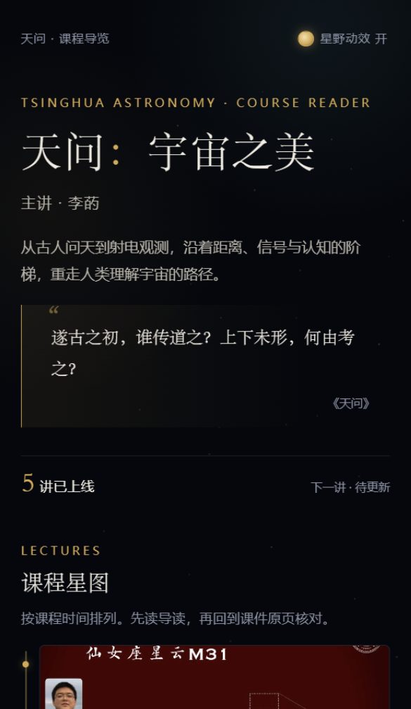
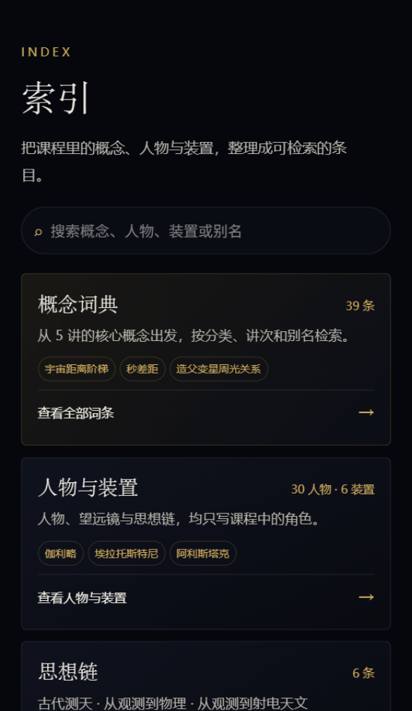
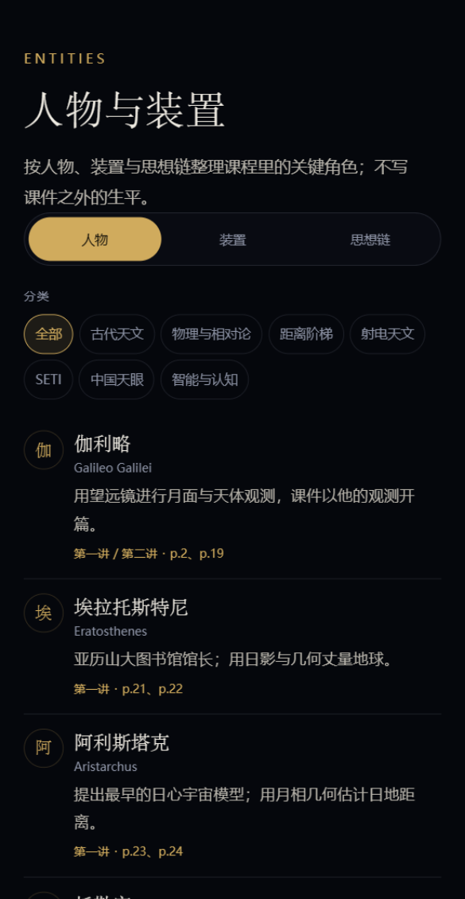
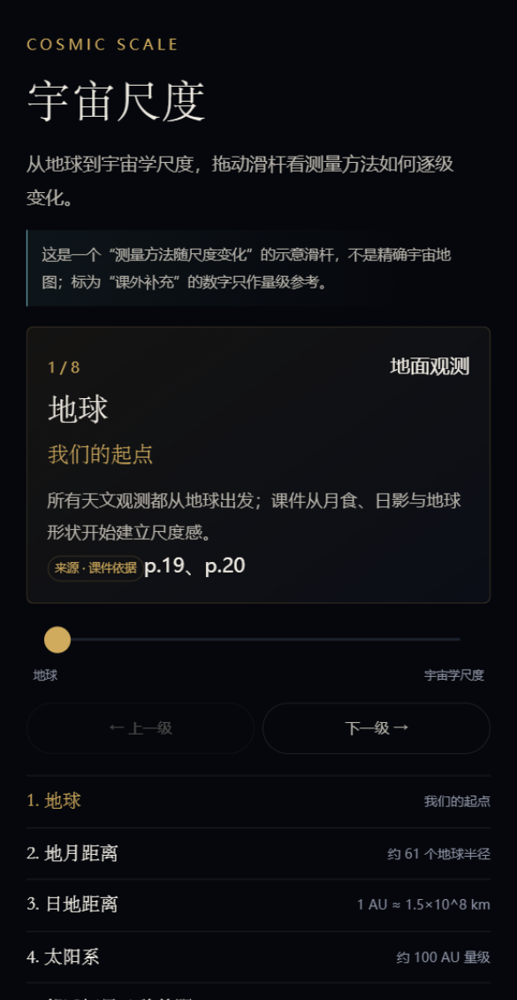
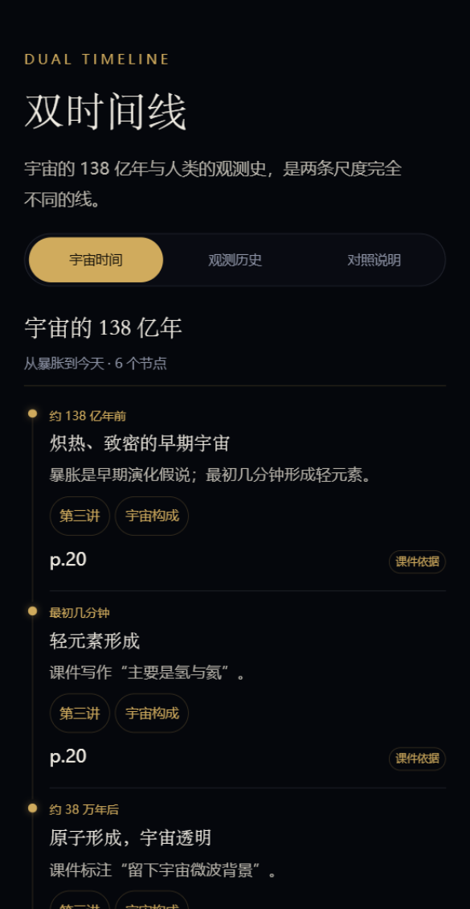
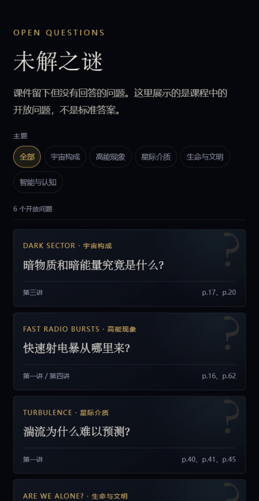
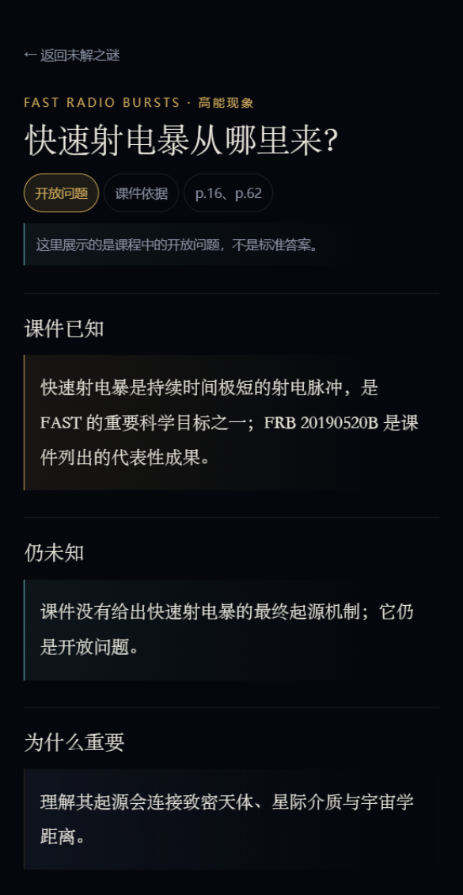
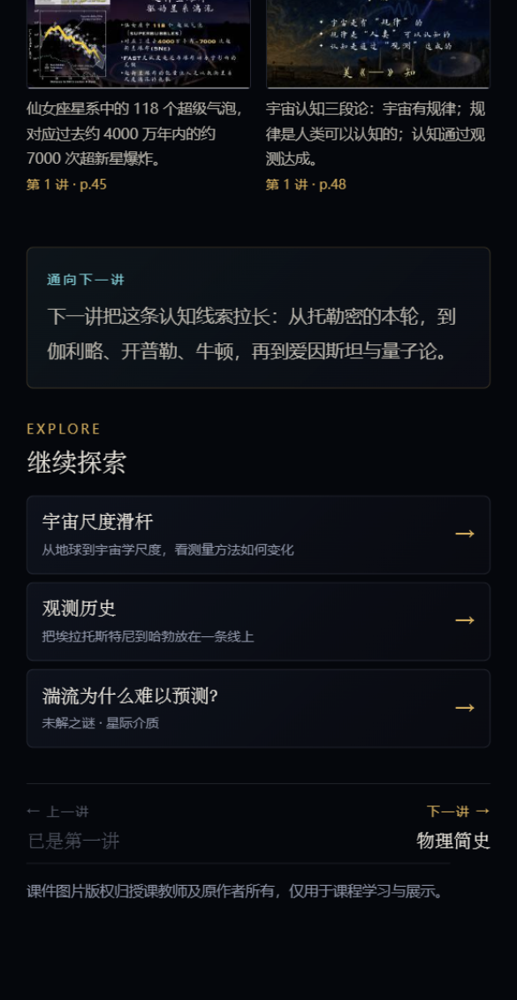

# v2.0.0 验收说明

- 验收日期：2026-10-31
- 发布标签：`v2.0.0`
- 仓库：`rainningsun/tianwen-cosmos-miniprogram`（private）
- 微信开发者工具：2.02.2609240，测试号 AppID
- 截图尺寸：390px 模拟器；页面内容为本次验收版本

## 1. 新 tab 结构

| 顺序 | Tab | 页面 | 入口 |
|---:|---|---|---|
| 1 | 课程 | `pages/index/index` | 启动页；课程星图、讲次、索引/探索入口 |
| 2 | 主线 | `pages/topic/topic` | 6 个专题；底部相关概念、人物/装置、探索链接 |
| 3 | 索引 | `pages/reference/reference` | 概念词典、人物与装置、思想链 |
| 4 | 探索 | `pages/explore/explore` | 宇宙尺度、双时间线、未解之谜 |
| 5 | 原页 | `pages/archive/archive` | 讲次原页索引；第六讲待更新 |

## 2. 模块入口

- 概念词典：`pages/reference/reference` → `pages/glossary/glossary` → `pages/glossary-detail/glossary-detail?id=...`
- 人物与装置：`pages/reference/reference` → `pages/entities/entities?mode=person|device|chain` → `pages/entity-detail/entity-detail?id=...`
- 宇宙尺度：`pages/explore/explore` → `pages/scale/scale`
- 双时间线：`pages/explore/explore` → `pages/timeline/timeline?mode=cosmic|human|compare`
- 未解之谜：`pages/explore/explore` → `pages/questions/questions` → `pages/question-detail/question-detail?id=...`
- 讲次页“继续探索”：每讲 1-3 个尺度/时间线/问题链接。

## 3. 验收结果

| 项目 | 结果 |
|---|---|
| tabBar | 正好 5 个：课程 / 主线 / 索引 / 探索 / 原页 |
| 旧模块 | 页面、数据、tab、入口与测试均已移除；无运行引用 |
| 概念词典 | 39 条；搜索、分类筛选、讲次筛选、详情、相关链接可用 |
| 人物与装置 | 30 位人物、6 个装置、6 条思想链；人物详情含规格、讲次、相关链接 |
| 宇宙尺度 | 8 层；对数映射；滑杆、上一级/下一级、层级点击可用；来源标注完整 |
| 双时间线 | 宇宙 6 节点、观测史 13 节点；双轨道与对照说明可用 |
| 未解之谜 | 6 条；主题筛选；详情含“课件已知 / 仍未知 / 为什么重要” |
| 跨模块链接 | 讲次 ↔ 词条/人物；专题 → 索引/探索；概念/人物 → 问题；均可打开 |
| 第六讲 | 首页与原页显示“待更新”；详情不生成死链 |
| 五讲详情 | 每讲 10 张原页；上一讲/下一讲正确；新增“继续探索” |
| 宽度 | 360 / 390 / 430px 全部无横向溢出 |
| 包体 | 主包 400.1 KB；三个分包 1.30 MB / 1.53 MB / 704.5 KB；总包约 3.84 MB |
| 静态校验 | `node scripts/validate-content.js` 通过（1 条 AppID 提醒） |
| 冒烟测试 | `node scripts/smoke-pages.js` 通过 |
| CI | GitHub Actions `validate` 连续 green |

## 4. 验收截图

| 课程首页 | 索引 |
|---|---|
|  |  |

| 人物与装置 | 宇宙尺度 |
|---|---|
|  |  |

| 双时间线 | 未解之谜 |
|---|---|
|  |  |

| 未解之谜详情 | 讲次页“继续探索” |
|---|---|
|  |  |

## 5. 待人工确认项

尺度滑杆中以下数字标为“课外补充”，只作量级示意，需课程负责人确认是否保留：

- 地月距离 3.84×10^8 m（课件原文只写“约 61 个地球半径”）
- 太阳系边界约 100 AU
- 银河系直径约 10 万光年
- 仙女座星系距离约 250 万光年
- 宇宙学尺度约 10^26 m / 百亿光年量级

完整说明与课件内部矛盾清单见 [`v2-data-notes.md`](v2-data-notes.md)。

## 6. 复验命令

```bash
node scripts/validate-content.js
node scripts/smoke-pages.js
```

在微信开发者工具中导入仓库根目录，编译后依次检查五个 tab、五个模块与五讲详情。
