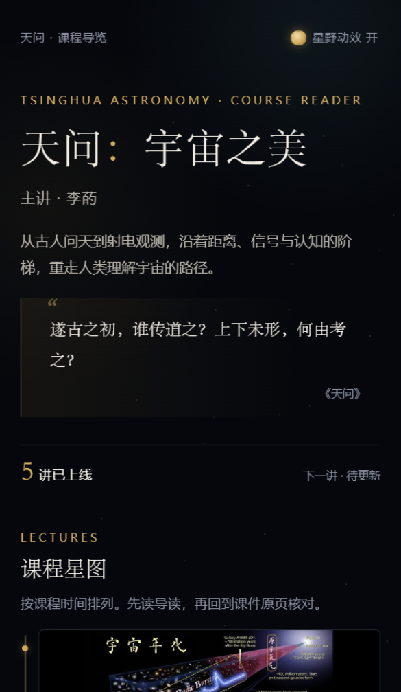
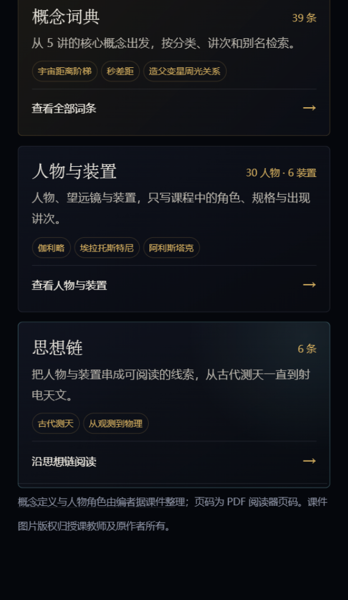
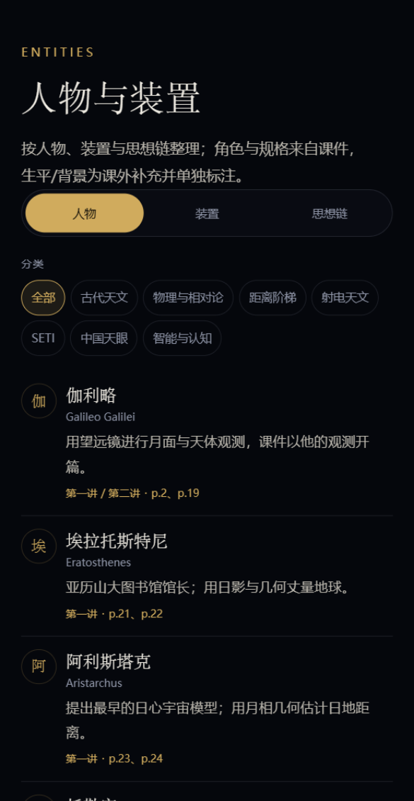
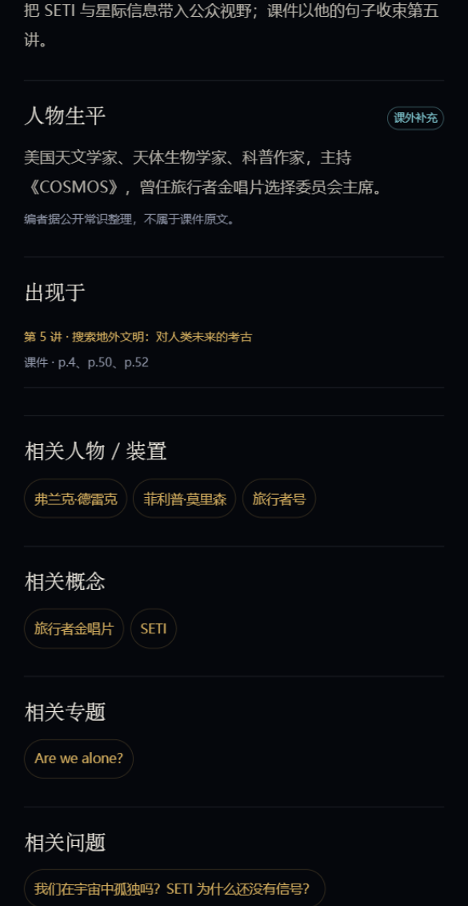
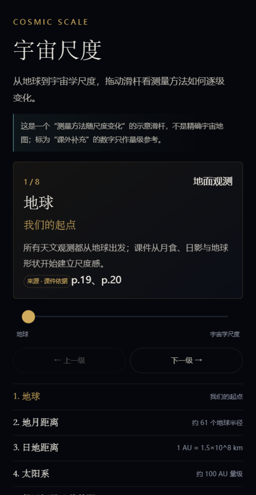
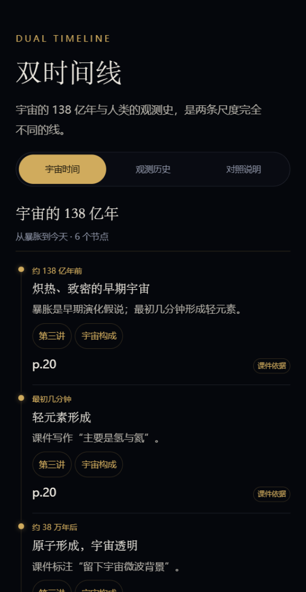
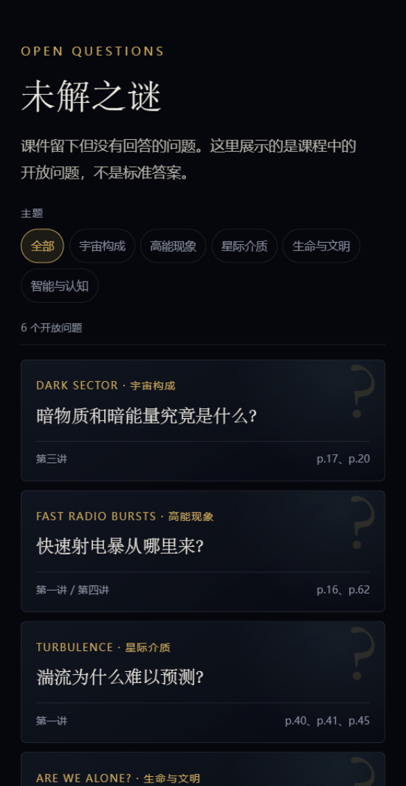
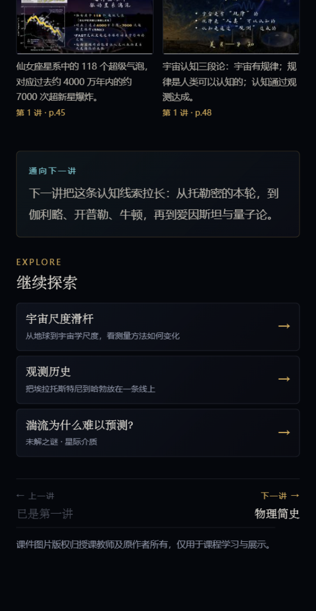

# v2.1.0 变更与验收说明

- 日期：2026-11-01
- 版本：`v2.1.0`
- 正式 AppID：`wx2e8e3cde13016238`
- 仓库：private，未上传体验版

## 1. 本次变更

- 配置正式 AppID。
- 第一讲课程封面改为第一讲 p.16“宇宙年代”页面。
- 索引页改为三张并列卡片：概念词典 / 人物与装置 / 思想链；思想链不再藏在人物与装置卡片下面。
- 30 位人物、6 个装置各补充 1 句课外生平/背景；详情页单列“人物生平 / 装置背景 · 课外补充”。
- 人物/装置详情预留授权图片字段；本次不加入未授权肖像或设备照片。
- 讲次公共逻辑拆入三个分包，修复代码质量扫描“主包未使用 JS”。
- `packageL2` 4 张最大原页压缩到 800px 宽，使分包低于 1.5MB 建议线。
- 新增名称/简介/服务类目建议、第六讲接入清单；校验增加已上线讲次覆盖检查。

## 2. 截图

| 课程首页（第一讲封面 p.16） | 索引三卡 |
|---|---|
|  |  |

| 人物与装置 | 人物生平补充 |
|---|---|
|  |  |

| 宇宙尺度 | 双时间线 |
|---|---|
|  |  |

| 未解之谜 | 讲次“继续探索” |
|---|---|
|  |  |

## 3. 代码质量扫描

| 项目 | 结果 |
|---|---|
| 主包大小 <1.5M | 已通过 |
| 主包未使用 JS | 已通过（讲次逻辑拆入分包） |
| 主包未使用组件 | 已通过 |
| 组件按需注入 | 已通过 |
| 图片/音频总量 ≤200K | 仍建议性未通过 |

图片/音频项是开发者工具对**全部代码包图片总量**的建议值。当前 50 张课件原页需要离线打包，压缩到 200KB 以下会严重损失可读性。可选方案：

1. 接受该建议项，保留离线原页；
2. 将原页迁到云存储/CDN，配置合法域名，换取扫描通过和更小包体；
3. 大幅降低原页分辨率（不推荐，影响课件阅读）。

相关说明已写入 README 与 `docs/v2-data-notes.md`。

## 4. 校验

```bash
node scripts/validate-content.js
node scripts/smoke-pages.js
```

- 静态校验通过；仅保留“正式 AppID，确认无私钥”提醒。
- 冒烟测试通过：5 tab、五个模块、5 讲详情、第六讲占位。
- 微信开发者工具编译通过；索引、人物详情、五讲详情已检查。
- 360 / 390 / 430px 关键页面无横向溢出。

## 5. 上架资料

名称、简介、服务类目与提审材料见 [`wechat-listing.md`](wechat-listing.md)。

## 6. 第六讲

第六讲仍为 `upcoming`。课件到位后按 [`lecture-6-integration.md`](lecture-6-integration.md) 接入主页、原页、主线、概念、人物/装置、时间线与问题；校验会强制检查概念/人物/专题覆盖。

## 7. 待确认

- 最终小程序名称与服务类目。
- 是否提供授权图片用于人物/装置详情。
- 是否上传体验版；需要管理员扫码，仓库不含私钥。
