# 《天问：宇宙之美》课程小程序

## 阶段性作业展示

- 课程：天问：宇宙之美
- 主讲：李菂
- 学生：________________
- 学号：________________
- 日期：2026-11-01
- 版本：v2.1.0
- 状态：可运行、未公开发布；第六讲保留“待更新”占位

> 这是一个把课程内容重新组织成“可读、可查、可探索”的原生微信小程序。当前为阶段性版本，已完成 5 讲内容和五个一级模块；第六讲等课件到位后接入。

## 1. 项目定位

课程原来的内容主要分布在 5 份 PDF 课件里。这个作业没有重写课程，而是把课件整理成一条更完整的阅读路径：

- 想按课程顺序读：从“课程”进入课程星图和讲次详情。
- 想理解课程观点：从“主线”读 6 篇跨讲专题。
- 想查概念、人物、装置：从“索引”检索。
- 想从尺度、时间、未知继续追问：从“探索”进入。
- 想核对原始课件：从“原页”按讲次进入。

设计原则：课件是唯一内容基线；所有观点、页码、原页都回到课件，不确定的内容不编造。

## 2. 当前完成度

| 项目 | 当前状态 |
|---|---|
| 已上线讲次 | 5 讲 |
| 第六讲 | `upcoming` 占位，不生成详情页、不生成死链 |
| 课件原页 | 5 讲 × 10 张 = 50 张，可全屏查看 |
| 思想主线 | 6 篇跨讲专题 |
| 概念词典 | 39 个词条，支持搜索、分类、讲次筛选 |
| 人物与装置 | 30 位人物、6 个装置、6 条思想链 |
| 宇宙尺度 | 8 个层级，对数映射滑杆 |
| 双时间线 | 6 个宇宙节点 + 13 个观测史节点 |
| 未解之谜 | 6 个开放问题 |
| 技术栈 | 原生 WXML / WXSS / JS，无 npm 依赖、无后端 |
| 正式 AppID | 已配置，尚未上传体验版 |

## 3. 五个一级模块

| Tab | 回答的问题 | 主要内容 |
|---|---|---|
| 课程 | 这门课讲什么？从哪里开始？ | 课程星图、讲次详情、第六讲占位、索引/探索入口 |
| 主线 | 课程的核心观点是什么？ | 6 篇专题 + 相关讲次/索引/探索链接 |
| 索引 | 某个概念/人物/装置是什么？ | 概念词典、人物与装置、思想链三张并列卡片 |
| 探索 | 尺度多大？时间多长？还有什么不知道？ | 宇宙尺度、双时间线、未解之谜 |
| 原页 | 原始课件在哪里？ | 按讲次索引 50 张关键页 |

## 4. 页面与功能展示

### 4.1 课程首页

课程星图是首页主体；第一讲封面已换为第一讲 p.16“宇宙年代”页面。首页保留《天问》引文、主讲信息、已上线讲次和第六讲“待更新”占位。

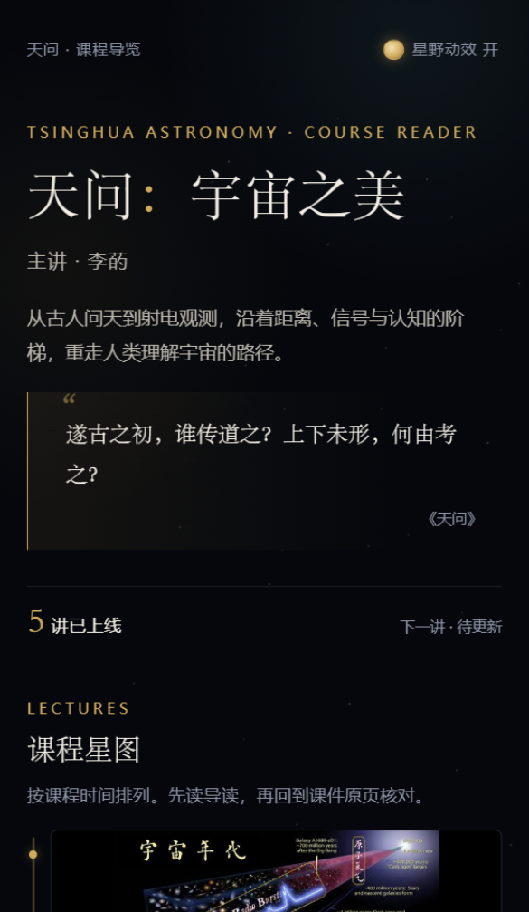

### 4.2 索引：三张并列卡片

索引页把“概念词典 / 人物与装置 / 思想链”做成三张并列卡片。思想链不再是人物与装置下面的附属内容，而是独立入口。

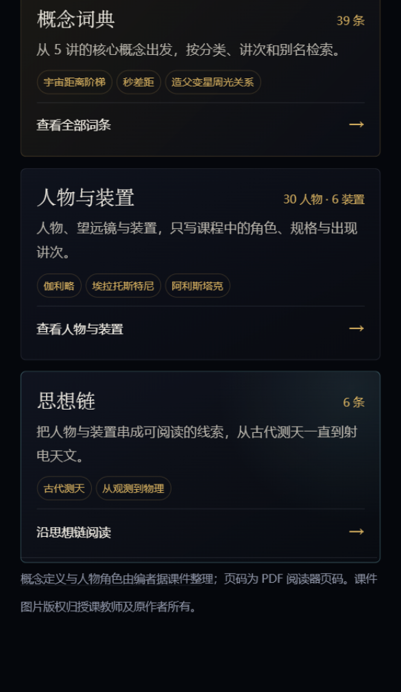

### 4.3 概念词典

39 个词条来自 5 讲概念的去重合并。支持中英文/别名搜索、分类筛选、讲次筛选；每个词条有定义、课件语境、相关概念、人物/装置、专题和开放问题。

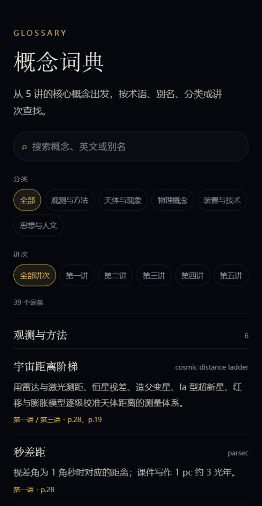

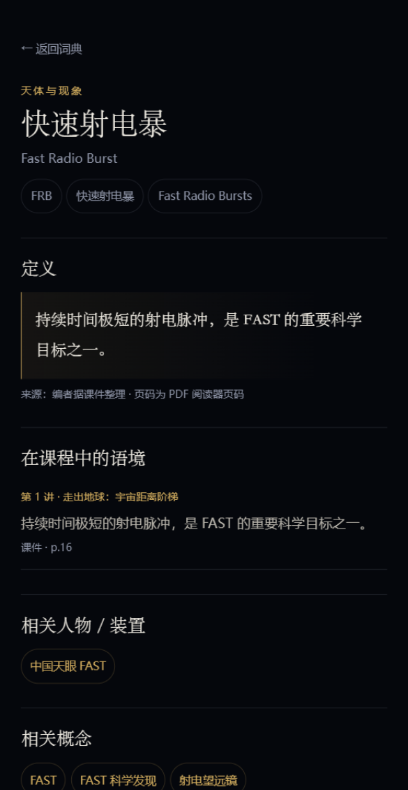

### 4.4 人物与装置

30 位人物、6 个装置、6 条思想链。人物/装置卡片只写课程中的角色；详情页另外提供一段“课外补充”的生平/背景，并明确标注不是课件原文。

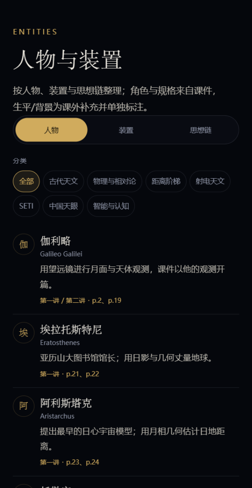

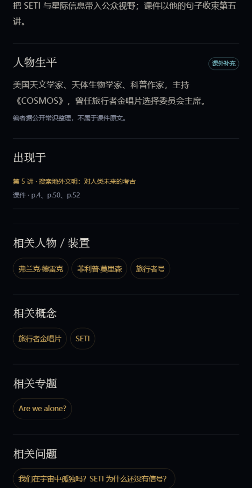

### 4.5 思想主线

6 篇专题把散落在各讲中的观点串起来。专题底部自动显示相关讲次、相关概念、相关人物/装置和“继续探索”入口。

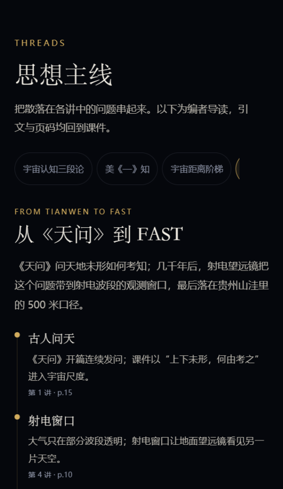

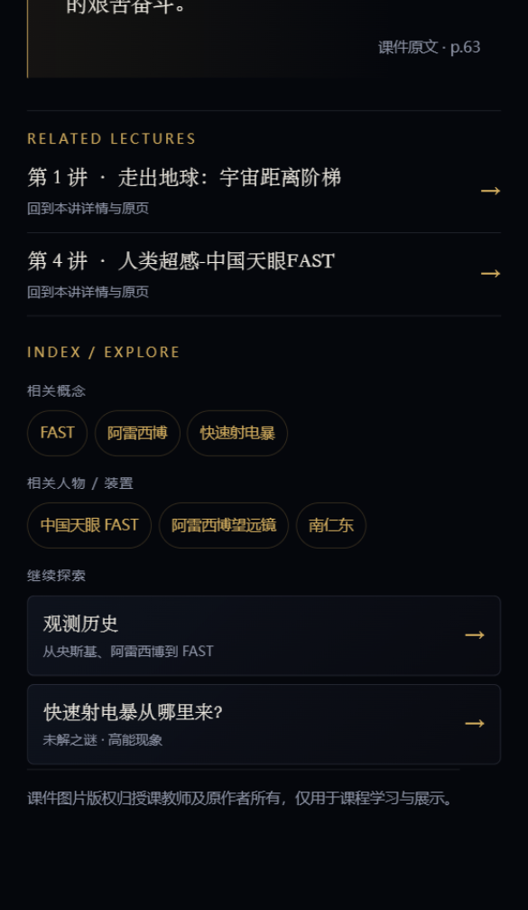

### 4.6 宇宙尺度

8 个层级，从地球到宇宙学尺度；滑杆按对数映射，支持上一级/下一级和直接点击层级。课件依据与“课外补充”分开标注，并明确说明这是“测量方法随尺度变化”的示意滑杆，不是精确宇宙地图。

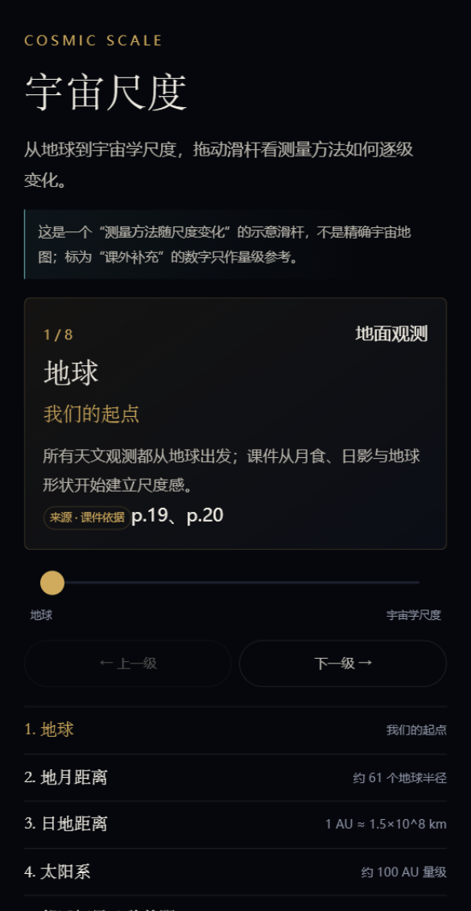

### 4.7 双时间线

两条独立轨道：宇宙的 6 个节点和人类观测史的 13 个节点。页面明确说明“时间与尺度不按比例”，避免把人类事件挤在一条线性轴末端。

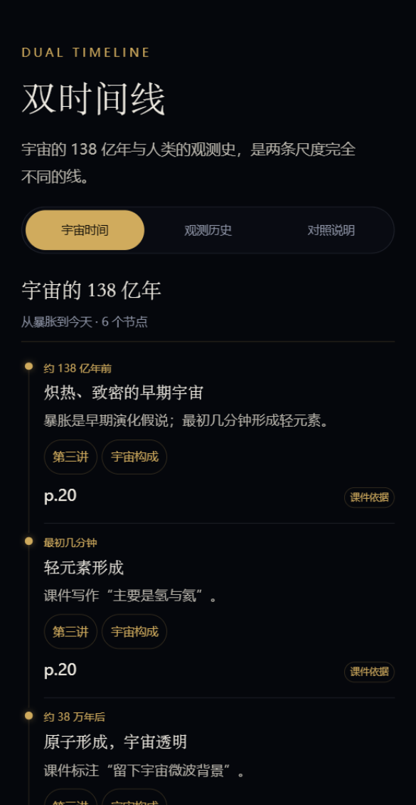

### 4.8 未解之谜

6 个开放问题按主题筛选；详情只写“课件已知 / 仍未知 / 为什么重要”，不把未知写成答案。

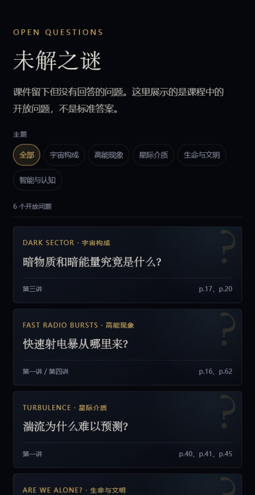

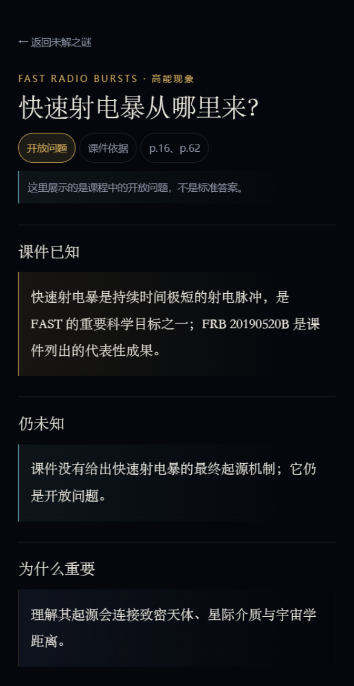

### 4.9 讲次详情与原页

每讲 10 张关键页；详情页保留导读、问题、概念、人物/装置、金句和原页画廊。概念和人物可以跳到索引；页面底部新增“继续探索”，推荐 1–3 个尺度/时间线/问题入口。

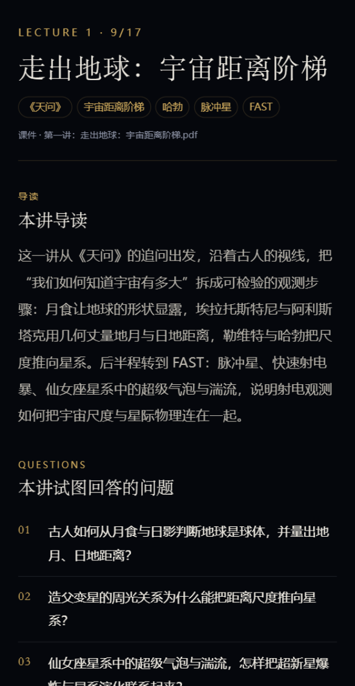

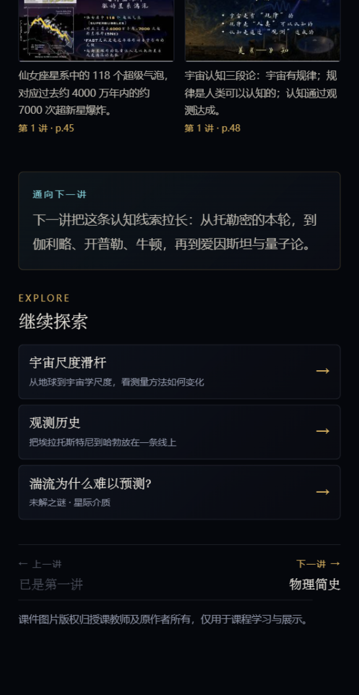

### 4.10 原页索引与第六讲占位

原页页按讲次列出 5 讲各 10 张关键页；第六讲显示“待更新”，不生成假内容或死链。

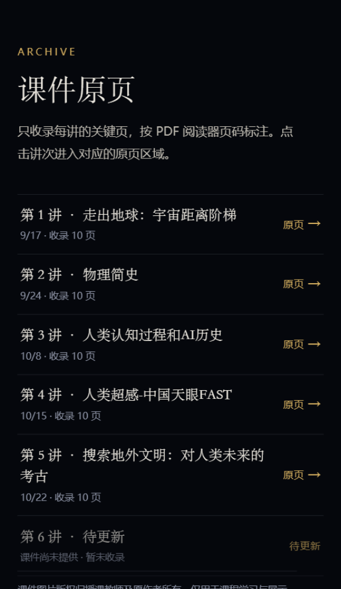

## 5. 内容规模与数据归属

| 内容 | 数量/来源 |
|---|---|
| 讲次 | 5 讲已上线 + 第六讲占位 |
| 原页 | 50 张，均来自课程 PDF，标注页码 |
| 专题 | 6 篇，跨讲组织 |
| 概念 | 39 条，来自 5 讲 concepts 去重合并 |
| 人物 | 30 位，去重合并；另补充课外生平 |
| 装置 | 6 个：伽利略望远镜、阿雷西博、GBT、FAST、JWST、旅行者号 |
| 思想链 | 6 条 |
| 尺度 | 8 层 |
| 时间线 | 6 个宇宙节点 + 13 个观测史节点 |
| 开放问题 | 6 个 |

内容只在一个地方定义：讲次在 `data/lectures.js`，专题在 `data/topics.js`，概念在 `data/glossary.js`，人物/装置在 `data/entities.js`，尺度和时间线、问题分别在对应数据文件里；页面通过 ID 互相链接，不复制全文。

## 6. 技术实现

- 原生微信小程序：WXML / WXSS / JS。
- 无 npm 依赖、无后端、无网络请求、无第三方 UI 库。
- 主包放 5 个 tab 与索引/探索页面；讲次详情分别在 `packageL1`、`packageL2`、`packageL3` 三个分包。
- 本地存储只保存“星野动效开关”和专题跳转状态，不收集个人信息。
- 原页图片按讲次分包，点击时可全屏预览。
- 静态校验：`node scripts/validate-content.js`。
- 页面逻辑冒烟测试：`node scripts/smoke-pages.js`。
- GitHub Actions 在 push/PR 时运行校验和冒烟测试。
- 代码质量扫描：主包大小、未使用 JS/组件、组件按需注入、插件体积均通过；“图片/音频总量 200K”为建议项，仍显示未通过（50 张课件原页离线打包导致，详见 README）。

## 7. 当前未完成的部分

1. **第六讲内容**：等课件到位后，按 `docs/lecture-6-integration.md` 接入课程、原页、主线、索引、探索等栏目。
2. **人物/装置图片**：暂未加入未授权肖像或设备照片；详情页已预留 `image` 字段，拿到授权素材后可补。
3. **公开发布**：仓库仍为 private，未上传体验版；正式 AppID 已配置，但需要管理员扫码上传。
4. **图片/音频扫描建议项**：不影响当前运行；若要求扫描全绿，需要把原页迁到云存储/CDN 或接受压缩带来的可读性损失。

## 8. 如何查看

- 源码仓库：`https://github.com/rainningsun/tianwen-cosmos-miniprogram`（private；需要邀请访问）。
- 微信开发者工具导入仓库根目录，`miniprogramRoot` 已配置为 `miniprogram/`。
- 正式 AppID：`wx2e8e3cde13016238`；体验版尚未上传，如需真机体验，需要把助教/老师加入体验成员。
- 本文件中的截图来自微信开发者工具 2.02.2609240，390px 模拟器；页面在当前版本编译通过，360/390/430px 无横向溢出。

## 9. 验收结果

- 静态校验通过（仅保留 AppID/私钥提醒）。
- 页面逻辑冒烟测试通过：5 个 tab、五个模块、5 讲详情、第六讲占位。
- 5 讲详情均可打开，每讲 10 张原页；上一讲/下一讲正确。
- 第六讲只显示待更新，不生成假内容或死链。
- 代码质量扫描：主包大小、主包未使用 JS、未使用组件、按需注入、插件体积通过；图片/音频总量建议项未通过。

## 10. 备注

- 本作业不修改原始 PDF，不提交 PDF 原件、私钥或小程序源码以外的敏感文件。
- 课程观点、引文、页码和课件原页来自课程 PDF；人物/装置生平和尺度补充数字已单独标注“课外补充”。
- 当前为阶段性提交，欢迎助教指出内容取舍、评分重点和第六讲接入范围。
